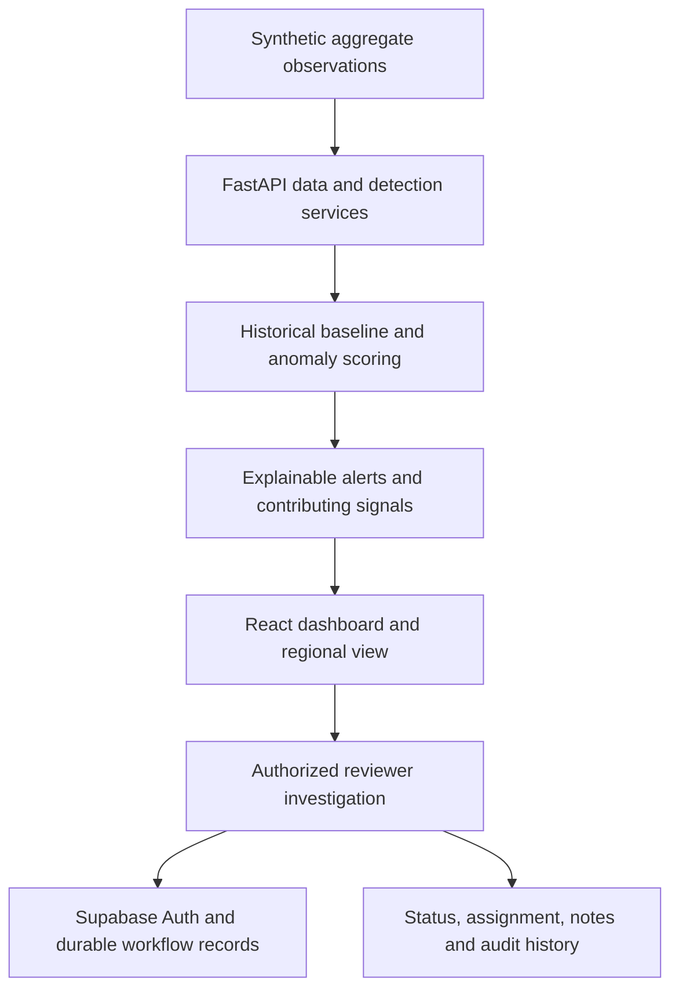

# AAROGYA ALERT

**Early-Warning Community Outbreak Engine** — a hackathon prototype for PS-021 that helps public-health reviewers investigate unusual changes in aggregated community-health indicators.

<p align="center">
  <a href="https://aarogya-alert.vercel.app/"><strong>Open the live dashboard</strong></a>
  ·
  <a href="https://aarogya-alert-api.onrender.com/docs"><strong>Explore the API</strong></a>
</p>

## The problem

Public-health teams may need to review signals from different sources before deciding whether an unusual change deserves further investigation. A single increase—such as higher pharmacy demand—does not establish that an outbreak is occurring.

AAROGYA ALERT demonstrates an early-warning workflow: compare aggregated indicators with historical baselines, bring related signals into view, explain why an alert was raised, and support a reviewer-led investigation with recorded changes and audit history.

> **Important:** This is a prototype using synthetic, aggregate-only observations and fictional regions. An alert indicates a reason to review, not a diagnosis, confirmed outbreak, or validated epidemiological prediction. It is not for clinical or operational public-health decisions.

## Live deployment

| Component | Link | Purpose |
|---|---|---|
| Frontend | [aarogya-alert.vercel.app](https://aarogya-alert.vercel.app/) | React dashboard |
| Backend | [Render API](https://aarogya-alert-api.onrender.com/) | FastAPI service |
| API documentation | [Interactive Swagger docs](https://aarogya-alert-api.onrender.com/docs) | Inspect available endpoints |
| Health check | [API health](https://aarogya-alert-api.onrender.com/api/health) | Service and synthetic dataset status |
| Source code | [GitHub repository](https://github.com/Hari-maker-del/aarogya-alert) | Application and tests |

The frontend is served from the Vercel domain root. The Vite base path is `/`; GitHub Pages deployment paths are not used.

## How it works



1. **Observe:** load aggregate indicators across fictional regions and dates.
2. **Compare:** evaluate each observation against prior history using a robust median/MAD baseline.
3. **Prioritize:** present unusual signals and supporting context, including related indicators and neighboring-region context.
4. **Investigate:** authorized reviewers can manage assignments, statuses, and notes.
5. **Review history:** workflow actions are recorded for auditability.

The demo intentionally distinguishes a pharmacy-demand-only signal from a signal supported by additional indicators. Correlation and geographic proximity are contextual clues—not proof of an outbreak.

## Main capabilities

- Regional monitoring of synthetic community-health indicators.
- Historical-baseline anomaly scoring and explainable review priorities.
- Alert details, contributing signals, uncertainty notes, and data-quality context.
- Reviewer authentication and role-based access for protected workflow actions.
- Investigation assignments, status changes, notes, and audit history.
- Interactive dashboard visualizations and a regional map.

## Architecture and technology

- **Frontend:** React 18, TypeScript, Vite, Recharts, Leaflet / React Leaflet, Lucide.
- **Backend:** Python, FastAPI, SQLite, pytest.
- **Reviewer workflow:** Supabase Auth and PostgreSQL with database-backed reviewer roles and protected workflow persistence.
- **Deployment:** Vercel (frontend) and Render (backend).
- **Quality checks:** frontend unit tests, TypeScript/Vite production build, Playwright end-to-end workflow, backend pytest suite, and an opt-in staging integration workflow.

## Run locally

### Prerequisites

- Node.js 18 or later (Node.js 20+ recommended) and npm.
- Python 3.11 or later.

### 1. Start the backend

From the repository root:

**Windows PowerShell**
```powershell
cd backend
py -3.11 -m venv .venv
.\.venv\Scripts\Activate.ps1
python -m pip install -r requirements.txt
python run.py
```

**macOS / Linux**
```bash
cd backend
python3 -m venv .venv
source .venv/bin/activate
python -m pip install -r requirements.txt
python run.py
```

The backend runs at [http://localhost:8000](http://localhost:8000). Open [http://localhost:8000/docs](http://localhost:8000/docs) for API documentation and [http://localhost:8000/api/health](http://localhost:8000/api/health) to check its status. The application seeds the synthetic dataset when the database is empty.

### 2. Start the frontend

Open a second terminal from the repository root:

```bash
npm install
```

Create a root-level `.env.local` file for the local API URL:

```dotenv
VITE_API_BASE_URL=http://localhost:8000
```

If using the reviewer sign-in and durable workflow features locally, also configure the frontend's Supabase URL and publishable key using the variable names in the frontend environment example (if present). Never put a Supabase service-role key in frontend environment variables.

Then run:

```bash
npm run dev
```

Open the URL printed by Vite, normally [http://localhost:5173](http://localhost:5173). The app uses the root path `/`, not `/aarogya-alert/`.

### 3. Run checks

Frontend tests and production build, from the repository root:

```bash
npm test
npm run build
```

Backend tests, from the `backend` directory with the virtual environment activated:

```bash
python -m pytest -q
```

To run the browser end-to-end suite, install the project's Playwright browser dependencies if needed, then run:

```bash
npm run test:e2e
```

## API notes

- `GET /api/health` — service and synthetic dataset status.
- `GET /api/alerts` — alert listing.
- `GET /api/detection/status` — latest detection status.
- `POST /api/detection/run` — triggers detection and **requires an active reviewer session**.
- Investigation endpoints support reviewer assignment, status updates, notes, and history; protected write actions require an authorized reviewer.

Use the live [OpenAPI documentation](https://aarogya-alert-api.onrender.com/docs) for the current request and response schemas. Do not run write operations against a shared or production environment just to experiment.

## Configuration and deployment

### Frontend

Configure the Vercel project to build the frontend from the repository root using the package scripts:

- Build command: `npm run build`
- Output directory: `dist`

Set the appropriate `VITE_*` variables in the Vercel project settings. Vite variables are bundled into browser assets; only public configuration, such as a Supabase publishable key, belongs there.

### Backend

The backend is deployed separately on Render. Configure the backend's environment variables in Render, including the allowed frontend origin and any required Supabase Auth/workflow settings. The API's health endpoint is:

`https://aarogya-alert-api.onrender.com/api/health`

The free Render filesystem is ephemeral. SQLite data can be lost on restart, spin-down, or redeploy unless persistent storage is configured. Supabase-backed investigation workflow records are intended to provide durable storage for that workflow; do not assume the local SQLite file is durable on a free instance.

### Staging safety

The repository includes an opt-in Supabase staging integration workflow. It must use a **separate staging Supabase project and a dedicated staging reviewer account**. Do not point staging tests at the production Supabase project. Follow the staging workflow's required environment secrets and write confirmation before running it. Staging probes create synthetic test records that are intentionally retained for auditability.

## Privacy, safety, and limitations

- The observations and region names/coordinates are synthetic and fictional.
- The prototype is not connected to real patient records and is not a diagnostic tool.
- Anomaly scores and review priorities are demonstrative, not clinically validated thresholds.
- Real-world deployment would require public-health domain validation, source governance, monitoring, appropriate security and retention controls, and review with relevant authorities.

## Contributing

Issues and pull requests are welcome. Please include tests for behavior changes and never commit secrets, production credentials, or real personal health information.
