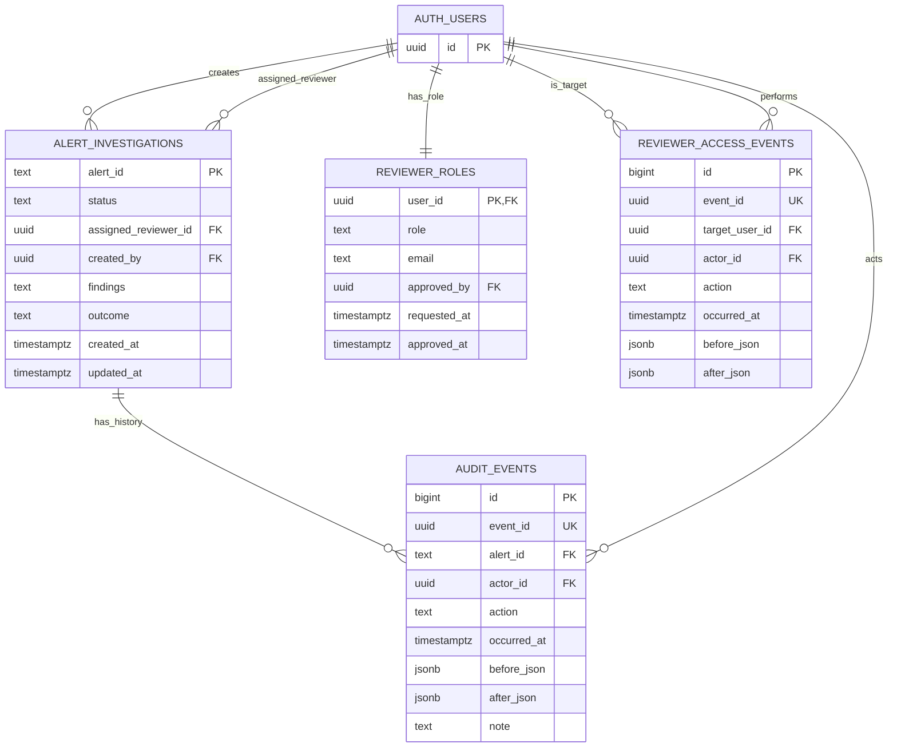

# CP3 and CP4 Deliverables — Aarogya Alert (PS-021)

## CP3: Database and ER diagram

The Supabase project currently contains these durable workflow tables:

- `alert_investigations`: one workflow record per alert; status, assigned reviewer, creator, findings, outcome and timestamps.
- `audit_events`: append-only history with actor, action, timestamp and before/after JSON.
- `reviewer_roles`: pending/reviewer/admin roles and approval metadata.
- `reviewer_access_events`: audit trail for reviewer approval/suspension.
- `auth.users`: Supabase-managed identities referenced by UUID foreign keys.

### Mermaid ER diagram

**Scope note:** The diagram represents the durable Supabase reviewer workflow. Regional observations and detected alerts are currently generated from the FastAPI synthetic demo dataset, not stored in these four workflow tables. Do not present the above as the complete health-observation schema.

### CP3 UI wireframes/screenshots to include

1. Overview dashboard — indicators, trends, active alerts.
2. Regional map — aggregated patterns; label data as synthetic.
3. Alert details — observed value, baseline, evidence, uncertainty, data quality.
4. Investigation screen — assignment, status, findings/outcome and audit timeline.

Use actual screenshots from the deployed app. Check RLS, foreign keys, append-only audit constraints, and roles for anonymous, pending, reviewer and admin accounts.

## CP4: API and integration demo

The frontend API client is configured with `VITE_API_BASE_URL` and attaches the current Supabase access token as a Bearer token. Audit actor identity must be derived server-side from the verified token; never trust a client-supplied actor UUID.

| Method | Endpoint | Purpose |
|---|---|---|
| GET | `/api/health` | Backend health and synthetic dataset status |
| GET | `/api/regions` | Regions |
| GET | `/api/alerts` | Alerts and filters |
| GET | `/api/alerts/{alert_id}` | Alert details |
| POST | `/api/detection/run` | Run demo anomaly detection |
| POST | `/api/alerts/{alert_id}/investigations` | Create workflow record |
| PATCH | `/api/alerts/{alert_id}/status` | Update status |
| PATCH | `/api/alerts/{alert_id}/assignment` | Assign a registered reviewer UUID |
| POST | `/api/alerts/{alert_id}/notes` | Add investigation note |
| GET | `/api/alerts/{alert_id}/history` | Read audit history |
| GET | `/api/reviewers/me` | Current role |

### Live demo sequence

1. Open dashboard and show the API-backed summary.
2. Open an alert and explain baseline, observed value, evidence and uncertainty.
3. Sign in as an approved reviewer.
4. Update status or assign a real registered reviewer UUID.
5. Refresh and reopen to check persistence.
6. Open audit history and verify actor and timestamp.
7. Optionally run detection and show alert counts.
8. State clearly that observations are synthetic; this does not prove real-world detection accuracy.

### CP4 verification checklist

- [ ] Frontend production build passes.
- [ ] Backend health endpoint responds.
- [ ] Authenticated API calls include the current Supabase token.
- [ ] Anonymous and pending users cannot mutate investigations.
- [ ] Approved reviewer can update status and add a note.
- [ ] Reviewer assignment uses a real Supabase user UUID.
- [ ] Workflow persists after refresh and service restart.
- [ ] Audit events cannot be updated/deleted and record the authenticated actor.
- [ ] Synthetic data and unvalidated detection limitations are disclosed.

## Honest limitations

- No real pharmacy or clinical feed is connected in the current demo.
- Synthetic signals demonstrate workflow only; they do not establish accuracy.
- Before real deployment, validate baselines, false-positive rates, suppression thresholds, access policies, retention and data-sharing authorization.
